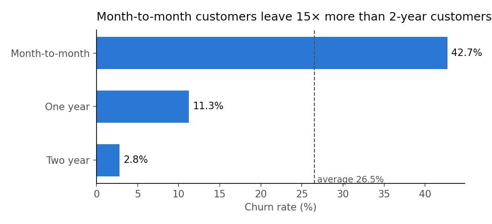
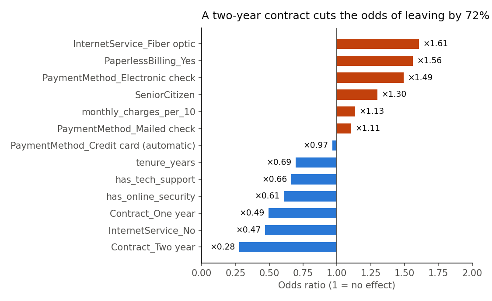

# Customer Churn Analysis (Python)

Analysis of 7,043 customers of a US telecom company (IBM Telco Customer Churn sample), built to answer one business question and end with concrete, quantified recommendations.

## Business Question

**Which customers are at risk of leaving, and what should the company do?**

- **26.5%** of customers left last month (1,869 customers).
- They took **$139,131 of monthly revenue** with them.

## 1. Who leaves?



| Group | Churn rate |
|---|---|
| Month-to-month contract | 42.7% |
| Two-year contract | 2.8% |
| Tenure 0–12 months | 47.4% |
| Electronic check | 45.3% |
| Fiber optic | 41.9% |
| **All customers** | **26.5%** |

These groups overlap (many new customers are also on month-to-month contracts), so a model is needed to separate their effects.

## 2. Which factors matter most? (logistic regression)

A logistic regression measures the effect of each factor while holding the others constant. It was trained on 75% of customers and tested on the 25% it had never seen.

| Metric | Result |
|---|---|
| Baseline accuracy (always predict "stays") | 73.5% |
| Model accuracy | 79.6% |
| ROC AUC | 0.84 |
| Churn rate among the 20% riskiest customers | 64.5% |
| Share of all leavers found in that 20% | 48.6% |



Odds ratios (above 1 = more likely to leave, below 1 = less likely):

| Factor | Odds ratio |
|---|---|
| Two-year contract (vs month-to-month) | ×0.28 |
| One-year contract (vs month-to-month) | ×0.49 |
| Each extra year of tenure | ×0.69 |
| Online security | ×0.61 |
| Tech support | ×0.66 |
| Electronic check (vs bank transfer) | ×1.49 |
| Fiber optic (vs DSL) | ×1.61 |

## 3. Recommendations

| # | Finding | Recommendation |
|---|---|---|
| 1 | The 20% riskiest customers contain ~49% of all leavers | Send the retention team a monthly risk list and call these customers first |
| 2 | Month-to-month: 42.7% churn vs 2.8% on two-year contracts | Offer a discount to switch to a one-year contract, starting with high-risk customers |
| 3 | First year: 47.4% churn | Onboarding programme in the first 3 months |
| 4 | Electronic check: 45.3% churn | Encourage automatic payment with a small one-off credit |
| 5 | Fiber optic: odds ×1.61 even at the same price | Investigate fiber service quality (outages, speed, support tickets) |
| 6 | Tech support and online security lower the odds | Bundle these services in retention offers |

**Potential impact (scenario):** the leavers in the top 20% represent about **$75,000 of monthly revenue** across the whole customer base. If a retention campaign kept 20% of them, that would save about **$15,000 per month (~$180,000 per year)**.

## Limits

- **Correlation is not causation.** Customers who choose long contracts may simply be more satisfied already. Each recommendation should be tested with an A/B test before a full rollout.
- The savings figure is a scenario, not a prediction: the real retention rate of a campaign is unknown.
- One snapshot of sample data, with no dates, so no trend over time.

## Data cleaning

- `TotalCharges` was stored as text: 11 customers had a blank value. All 11 had a tenure of 0 months (they had not paid yet), so the blanks were set to 0 rather than to an average.
- No duplicate customers.

## How to run

```bash
pip install pandas matplotlib scikit-learn jupyter
jupyter notebook churn_analysis.ipynb
```

## Tools

Python (pandas, matplotlib, scikit-learn), Jupyter Notebook

## Files

- `churn_analysis.ipynb`: the full analysis, step by step
- `data/telco_churn.csv`: the dataset (IBM Telco Customer Churn sample)
- `charts/`: the charts used in this README
